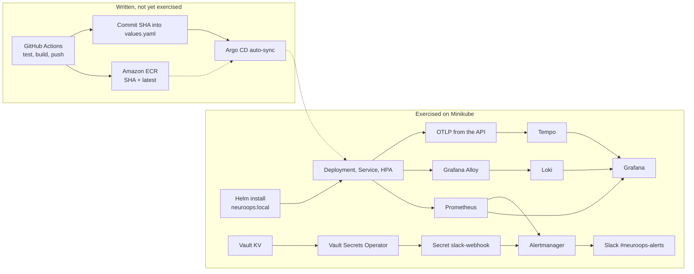
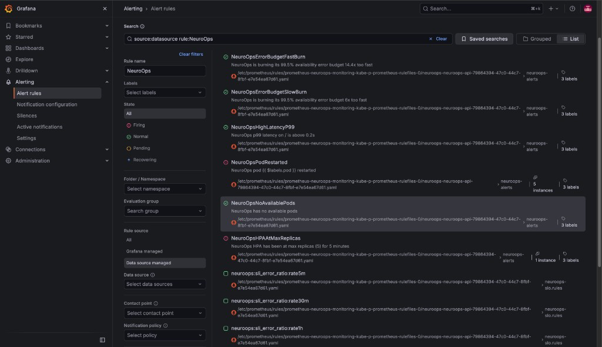
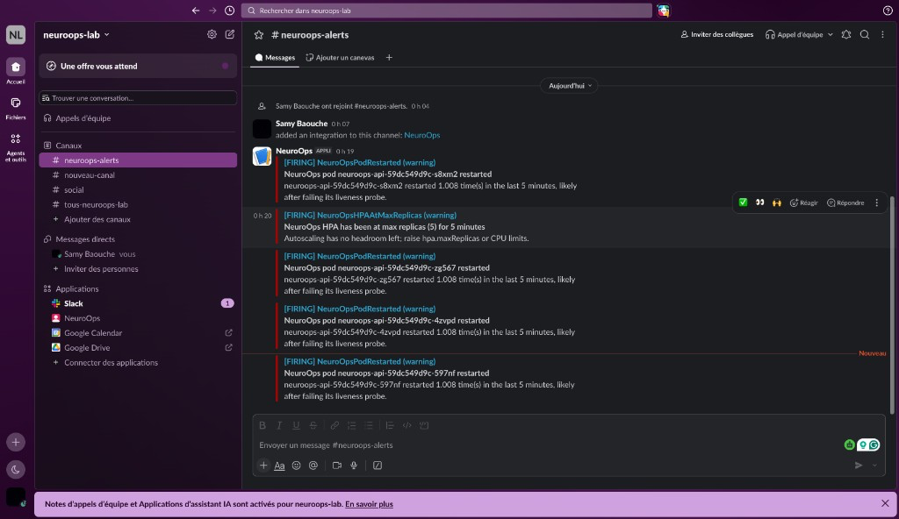
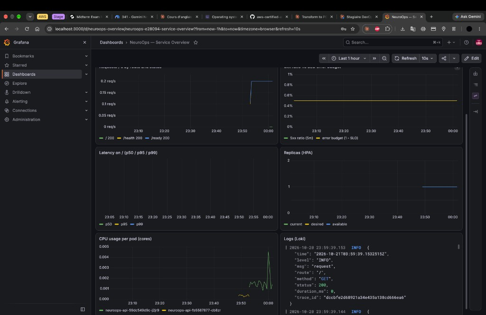

# NeuroOps

A self-healing, autoscaling, SLO-monitored Go service on Kubernetes — failures injected under load, measured, diagnosed, and fixed.

[](app/go.mod)
[](charts/neuroops)
[](charts/neuroops/Chart.yaml)
[](charts/neuroops/templates/prometheusrule.yaml)
[](vault/setup.sh)

Personal platform project by [Samy Baouche](https://github.com/SamyBaouche). The numbers below were measured on a local Minikube cluster (Docker driver, 4 CPU, 8 GB) on an Apple Silicon Mac, with 100 concurrent k6 clients sending `GET /` through `minikube service`. They are not a production SLO report.

**Run and measured:** Helm install of the chart, Prometheus / Grafana / Loki / Tempo, failure injection under k6 load, HPA scale-up, and the alert path Alertmanager → Slack with the webhook synced from Vault.

**Written, not yet exercised:** GitOps. GitHub Actions can push the image to Amazon ECR and commit the new tag into `charts/neuroops/values.yaml`; `argocd/application.yaml` would sync that commit. That path has not been run end to end. The measurements used a local image (`neuroops:local`) installed with Helm.

## Results at a glance

Same cluster and client shape for every row: Minikube on Apple Silicon, Docker driver, 4 CPU, 8 GB, 100 k6 VUs, `GET /`, via the `minikube service` tunnel.

| Run | What changed | Requests | Error rate | Availability | p99 | Notes |
| --- | --- | ---: | ---: | ---: | ---: | --- |
| Baseline, 2 min, 2 replicas, no failures | — | 2,006,660 | 0.00% | 100% | 31.9 ms | ~16,700 req/s, p50 4.25 ms, p95 14.6 ms |
| Failure injection, 6 min | `readinessProbe.periodSeconds: 5` | 4,423,709 | 3.56% | 96.44% | 46.1 ms | 99.5% SLO missed |
| Failure injection, 6 min, 10 failures | `readinessProbe.periodSeconds: 1` | 2,677,076 | 2.22% | 97.78% | 84.4 ms | 10/10 recovered with no manual restart. Time to Ready: avg 19.1 s, min 11.8 s, p95 26.1 s |

Later runs sat around 6–7k req/s. The laptop and the tunnel were saturated after about an hour of tests, so that drop is not a regression in the service.

Autoscaling, same machine: the HPA scaled from 2 to 5 pods under CPU load (target 50%). `NeuroOpsHPAAtMaxReplicas` fired after 5 minutes at `maxReplicas: 5`.

The 99.5% availability SLO was **not** met during either failure run. Burn-rate alerts stayed quiet on purpose: 3.56% is under the fast-burn threshold of 14.4 × 0.5% = 7.2%.


## Architecture



The dotted Argo CD edge is the intended delivery path. The cluster that produced the table was installed with Helm and `imagePullPolicy: Never`.

## What it demonstrates

- Self-healing: `/fail` makes `/health` return 500 and `/ready` return 503. Readiness removes the pod from the Service; liveness restarts it. 10/10 injected failures recovered with no kubectl intervention.
- Autoscaling: HPA from 2 to 5 pods at 50% CPU, then a real `NeuroOpsHPAAtMaxReplicas` warning because 5 was the cap.
- SLO burn-rate alerting: multi-window rules (14.4× on 1h and 5m, 6× on 6h and 30m) instead of a single static 5xx threshold.
- Observability: Prometheus metrics, JSON logs in Loki, OpenTelemetry traces in Tempo. Each request log carries `trace_id`, and Grafana is configured to link that field to Tempo.
- Secrets: the Slack webhook lives in Vault. The Vault Secrets Operator syncs it into a Kubernetes Secret. Alertmanager reads that Secret.
- GitOps design: chart + Argo CD Application + a CI job that bumps the image tag. Not yet exercised.

## Reliability experiment

### Hypothesis

With 2 replicas, a pod that fails `/ready` is removed from the Service before the kubelet restarts it, so user-facing `GET /` stays inside a 99.5% availability SLO while k6 runs.

### Method

1. Two replicas (the chart default is `hpa.minReplicas: 1`; it was raised so one restart was not a total outage).
2. `k6 run` with 100 VUs against `GET /` for 6 minutes (`loadtest/traffic.js`).
3. In another terminal, `scripts/inject-failures.sh` picked a random Running pod every 30 seconds and called `GET /fail` from inside the pod.
4. k6 `http_req_failed` is the error rate. Availability is 1 minus that rate. The script timed container restart and Ready.

`/fail` flips an in-memory flag. After that, `/` and `/ready` return 503 and `/health` returns 500 until the process is replaced.

### Results

| | Before (`periodSeconds: 5`) | After (`periodSeconds: 1`) |
| --- | --- | --- |
| Requests | 4,423,709 | 2,677,076 |
| Errors | 3.56% | 2.22% |
| Availability | 96.44% | 97.78% |
| p99 | 46.1 ms | 84.4 ms |
| Recoveries | — | 10/10, no manual restart |
| Time to Ready | — | avg 19.1 s, min 11.8 s, p95 26.1 s |

Error rate dropped by about 38% relative to the first run (3.56% → 2.22%). The SLO was still missed. p99 was worse on the second run; throughput on later runs was also lower (~6–7k req/s versus ~16,700 on the fresh baseline) because the laptop and the tunnel were saturated.

### Root cause

The process returns 503 as soon as `/fail` is called. With `periodSeconds: 5`, the Endpoints object was only updated on that interval, so the Service kept sending traffic to the broken pod for up to 5 seconds. At this request rate that was on the order of one fifth of in-flight traffic, which is enough to miss a 0.5% error budget.

Burn-rate alerts did not fire. A 3.56% error ratio does not cross 7.2% (14.4 × the 0.5% budget) on both the 1h and 5m windows. The page would fire for a fast, severe burn, not for this probe-shaped leak. `NeuroOpsPodRestarted` did fire, and it reached Slack.

### Fix

`readinessProbe.periodSeconds` went from 5 to 1 in `charts/neuroops/values.yaml`. `failureThreshold` stays 1, so one failed check removes the pod. Liveness stays at 5 seconds × 2 failures, so the restart still happens about 10 seconds after the probe starts failing, after the pod is already out of the Service.

### Next hypothesis (not verified)

k6 reuses keep-alive connections. kube-proxy only picks a backend for a **new** connection, so an existing connection stays pinned to the failing pod until that container restarts. That would explain why a 1-second readiness period still left 2.22% errors.

Planned check: send `Connection: close` on 503 responses, then run the same 6-minute, 10-failure test again. Not implemented, not measured.

## Screenshots



The rules are loaded from the PrometheusRule in the chart. This frame is the quiet state. The firing path is the Slack capture below.



This is the path that was actually run: injected failure → liveness restart → Prometheus rule → Alertmanager → Slack webhook, with the webhook Secret synced from Vault by the Vault Secrets Operator.



Alloy ships container logs to Loki. The API logs one JSON line per request and skips healthy probe calls. Grafana's Loki datasource maps `trace_id` to the Tempo datasource. There is no Tempo screenshot in this repo.

The HPA scale-up (the replica series reaching 5) is in the hero dashboard above, not a separate image. `docs/images/` has no `hpa-scaling.png` and no `tempo-trace.png`.

## Design decisions

**Readiness fails before liveness.** Readiness period is 1 second with `failureThreshold: 1`. Liveness period is 5 seconds with `failureThreshold: 2`. The pod leaves the Service on the first failed ready check. The kubelet restarts it only after two failed health checks. Swapping those numbers would restart a pod that is still receiving traffic, or keep a dead pod in the Service for longer.

**No `replicas` on the Deployment while the HPA is enabled.** `charts/neuroops/templates/deployment.yaml` omits `spec.replicas` when `hpa.enabled` is true. If both the Deployment and the HPA set the replica count, Argo CD (or the next Helm upgrade) resets the Deployment and fights the autoscaler.

**Multi-window burn rates, not a static 5xx threshold.** The Google SRE workbook fast burn is 14.4× the budget on both 1 hour and 5 minutes (page). The slow burn is 6× on both 6 hours and 30 minutes (ticket). The budget is `1 - 0.995 = 0.005`, so the fast page is 7.2% errors. A static "5xx > 1% for 1 minute" rule would have paged on the probe experiment; the burn-rate rules correctly did not. Recording rules `neuroops:sli_error_ratio:rate{5m,30m,1h,6h}` feed the alerts. The SLI is `neuroops_http_requests_total` for routes `/` and `/load` only, so probe traffic does not dilute it.

**CRD-gated templates.** ServiceMonitor, PrometheusRule, AlertmanagerConfig, and the Vault resources render only when the corresponding CRDs are installed. `helm install` works on a cluster that has neither the Prometheus Operator nor the Vault Secrets Operator. A later `helm upgrade`, after `monitoring/install.sh` or `vault/setup.sh`, picks the extra objects up.

**Vault Kubernetes auth, read-only.** `vault/setup.sh` enables KV v2 at `kv/`, Kubernetes auth, and policy `neuroops-read` with `read` on `kv/data/neuroops/*` only. The role `neuroops` is bound to ServiceAccount `neuroops/neuroops-vault`. The chart's VaultStaticSecret refreshes every 30 seconds into a Secret of the same name. Audit logs go to stdout so Alloy can ship them to Loki.

**Image tags are the git SHA, plus `latest`.** The workflow pushes both. Argo CD is pointed at the SHA written into `values.yaml`, not at `latest`. `latest` moves; a SHA does not. This job has not been executed against the cluster yet.

## The service

Go 1.26 module in `app/`. One process, port 8080.

| Method and path | Role | Healthy | After `/fail` |
| --- | --- | --- | --- |
| `GET /` | user traffic | 200 `NeuroOps is running` | 503 |
| `GET /health` | liveness probe | 200 `healthy` | 500 |
| `GET /ready` | readiness probe | 200 `ready` | 503 |
| `GET /fail` | latch failure mode until the process is restarted | — | 500 |
| `GET /load` | ~5 s CPU busy loop, used to trip the HPA | 200 | 200 (the loop still runs) |
| `GET /metrics` | Prometheus registry | 200 | 200 |

`/fail` sets an `atomic.Bool`. Nothing persists it. A restart clears the flag, which is the self-healing behavior under test.

Metrics, all on the chart's own registry:

- `neuroops_http_requests_total{route,method,code}`
- `neuroops_http_request_duration_seconds` histogram, buckets 5 ms, 10 ms, 25 ms, 50 ms, 100 ms, 200 ms, 500 ms, 1 s, 2.5 s, 5 s, 10 s
- `neuroops_failure_mode` gauge, 1 after `/fail`
- default Go and process collectors

Logs are JSON via `log/slog`: one line per request with `route`, `method`, `status`, `duration_ms`, and `trace_id` when a span exists. Healthy `/health` and `/ready` calls are not logged. The kubelet hits both every few seconds.

Tracing uses `otelhttp` and OTLP/gRPC. It is a no-op unless `OTEL_EXPORTER_OTLP_ENDPOINT` is set. The chart sets that to `http://tempo.monitoring.svc.cluster.local:4317` when `tracing.enabled` is true, and sets `OTEL_SERVICE_NAME` to `neuroops-api`. `charts/neuroops/values-local.yaml` turns tracing off so the API still starts before Tempo exists.

On SIGINT or SIGTERM the server stops accepting new connections and waits up to 10 seconds for in-flight requests. The same timeout shuts the tracer provider down.

`app/main_test.go` covers the healthy paths, a 404, failure mode on `/`, `/health`, and `/ready`, and the metric names. CI runs `go test -race ./...`.

The image is a multi-stage Dockerfile: `golang:1.26-alpine` builder, `CGO_ENABLED=0` static binary, `alpine` runtime, port 8080.

Chart defaults that match the probes and the HPA:

- CPU request `100m`, limit `500m` (`100m` = 0.1 CPU, `500m` = 0.5 CPU)
- HPA min 1, max 5, CPU target 50% (the experiment raised min to 2)
- Service type `NodePort`, port 8080, selector `app: neuroops-api`
- Deployment name `neuroops-api`, HPA name `neuroops-hpa`, namespace `neuroops`

## Operator CLI

`cli-go/` is a Cobra CLI and a Bubble Tea TUI. It calls the API. It does not deploy anything.

```bash
cd cli-go
go run . health --url "$URL"
go run . ready --url "$URL"
go run . load --url "$URL"
go run . fail --url "$URL"
go run . tui --url "$URL"
```

`--url` defaults to `http://127.0.0.1:8080`. Commands: `tui`, `health`, `ready`, `load`, `fail`. There is no CLI screenshot in `docs/`.

## Terraform

`terraform/` creates one resource: `aws_ecr_repository`, name `kubepulse-aws`, region `us-east-1`, `scan_on_push = true`, tag mutability `MUTABLE`. Provider `hashicorp/aws` `~> 6.0`. Output `ecr_repository_url`.

It does not create a VPC, an EKS cluster, IAM roles, or KMS keys.

```bash
cd terraform
terraform init
terraform apply
```

## CI and the GitOps design

`.github/workflows/ci-cd.yml` runs on push and pull request to `main`.

1. `build-test-push` — checkout, Go from `app/go.mod`, `go test -race`, `go build`, AWS credentials from GitHub Actions secrets, ECR login, `docker build` in `app/`, push the git SHA tag and `latest` to `us-east-1` repository `kubepulse-aws`.
2. `gitops-update` — only on a push to `main`. `yq` writes `image.repository` and `image.tag` (the full SHA) into `charts/neuroops/values.yaml`, then commits `chore(gitops): deploy <sha> [skip ci]` and pushes. A commit made with `GITHUB_TOKEN` does not start another workflow run.

`argocd/application.yaml` points at this public repo, path `charts/neuroops`, branch `main`, namespace `neuroops`, with automated sync, prune, and self-heal.

None of that has been watched onto a cluster. Two gaps are called out under Lessons and Limitations: the workflow builds a single-architecture image on `ubuntu-latest`, and this Mac's Minikube needs `linux/arm64`.

## Monitoring stack

`monitoring/install.sh` installs pinned charts into namespace `monitoring`:

| Chart | Version | Role |
| --- | --- | --- |
| `prometheus-community/kube-prometheus-stack` | 92.3.0 | Prometheus, Alertmanager, Grafana, kube-state-metrics, node-exporter |
| `grafana/loki` | 7.3.0 | logs, single binary, filesystem, 168 h retention |
| `grafana/tempo` | 1.24.4 | traces, OTLP 4317/4318, query 3200, 72 h retention |
| `grafana/alloy` | 1.13.1 | pod logs and Kubernetes events → Loki |

Prometheus is configured with empty ServiceMonitor and rule selectors so it loads objects from any namespace. The chart's ServiceMonitor and PrometheusRule still carry `release: neuroops-monitoring`. Grafana gets Loki and Tempo datasources; the Loki datasource extracts `"trace_id":"..."` and links it to Tempo.

The chart also ships a Grafana dashboard, "NeuroOps — Service Overview", as a ConfigMap labeled `grafana_dashboard: "1"`.

Alerts in `charts/neuroops/templates/prometheusrule.yaml`:

| Alert | Condition | Severity |
| --- | --- | --- |
| `NeuroOpsErrorBudgetFastBurn` | error ratio > 14.4× budget on both 1h and 5m, for 2m | critical |
| `NeuroOpsErrorBudgetSlowBurn` | error ratio > 6× budget on both 6h and 30m, for 15m | warning |
| `NeuroOpsHighLatencyP99` | p99 of `/` above 200 ms, for 5m | warning |
| `NeuroOpsPodRestarted` | container restart in the last 5m | warning |
| `NeuroOpsNoAvailablePods` | 0 available replicas, for 1m | critical |
| `NeuroOpsHPAAtMaxReplicas` | current replicas ≥ max, for 5m | warning |

Slack is off unless `alerting.slack.enabled` is true. The receiver reads Secret `slack-webhook`, key `url`, channel `#neuroops-alerts`.

## Secrets

```bash
SLACK_WEBHOOK_URL=https://hooks.slack.com/services/XXX ./vault/setup.sh
```

The script installs Vault chart `0.34.1` (Vault 2.0.4) and Vault Secrets Operator `1.6.0`, initializes with one unseal key, unseals, and is safe to re-run (a second run only unseals). The unseal key and root token are written to `vault/.vault-init.json`, which is git-ignored.

`vault/measure-rotation.sh` times how long a Vault write takes to show up in the Kubernetes Secret. No timing from that script is published here.

Lab settings, not a production Vault: file storage, TLS off inside the cluster, manual unseal, root token still used by the scripts. On AWS the replacement is KMS auto-unseal, TLS, and a revoked root token.

## Repository layout

```text
app/                  Go API, tests, multi-stage Dockerfile
cli-go/               Operator CLI and TUI (not the deploy path)
charts/neuroops/      Helm chart: workload, HPA, SLO rules, dashboard, Vault CRs
argocd/               Argo CD Application (not yet exercised)
monitoring/           Pinned Helm values and install.sh for metrics, logs, traces
vault/                Vault values, setup.sh, rotation timer
loadtest/             k6: traffic.js (GET /), autoscale.js (GET /load)
scripts/              inject-failures.sh
terraform/            ECR repository only
.github/workflows/    Test, image push, values.yaml tag bump
docs/images/          Screenshots from the Minikube runs
```

## Quickstart

Minikube on macOS, Apple Silicon, Docker driver. The `minikube service` command opens a tunnel and holds that terminal. Leave it open or k6 talks to a closed port.

```bash
minikube start --driver=docker --cpus=4 --memory=8192
minikube addons enable metrics-server

minikube image build -t neuroops:local app/
helm upgrade --install neuroops charts/neuroops -n neuroops --create-namespace \
  -f charts/neuroops/values-local.yaml

./monitoring/install.sh
# CRDs now exist; upgrade so ServiceMonitor, PrometheusRule, and tracing render.
helm upgrade neuroops charts/neuroops -n neuroops \
  -f charts/neuroops/values-local.yaml \
  --set tracing.enabled=true

SLACK_WEBHOOK_URL=https://hooks.slack.com/services/XXX ./vault/setup.sh
# Second upgrade: Vault CRDs exist, and Alertmanager should page Slack.
helm upgrade neuroops charts/neuroops -n neuroops \
  -f charts/neuroops/values-local.yaml \
  --set tracing.enabled=true \
  --set alerting.slack.enabled=true \
  --set hpa.minReplicas=2
```

Keep `--set` flags from the previous upgrade. Helm replaces the release values; dropping `tracing.enabled` or `values-local.yaml` points the Deployment back at a pullable tag and turns tracing off.

```bash
# terminal 1 — leave this running
minikube service neuroops-service -n neuroops --url

# terminal 2
k6 run -e BASE_URL="$URL" -e VUS=100 -e DURATION=2m loadtest/traffic.js
k6 run -e BASE_URL="$URL" -e VUS=100 -e DURATION=6m loadtest/traffic.js
INTERVAL=30 ./scripts/inject-failures.sh 10
k6 run -e BASE_URL="$URL" loadtest/autoscale.js
```

Grafana:

```bash
kubectl port-forward svc/neuroops-monitoring-grafana 3000:80 -n monitoring
kubectl get secret neuroops-monitoring-grafana -n monitoring \
  -o jsonpath="{.data.admin-password}" | base64 -d; echo
```

User `admin`, URL `http://localhost:3000`.

Vault UI after a reboot (the pod comes up sealed):

```bash
./vault/setup.sh
kubectl port-forward svc/vault 8200:8200 -n vault
```

## Lessons learned

**`read` under `set -e`.** In `scripts/inject-failures.sh`, `read` returns 1 when kubectl's jsonpath has no trailing newline. Combined with `set -euo pipefail` the script exited during the wait loop and printed nothing. The `read` is now `|| true`. The bug hid a failed experiment behind an empty terminal.

**A green run that injected nothing.** One "after" k6 run reported 0% errors. Restart count was 0. The injector had not reached a pod. A 0% error rate is not evidence unless the script printed `Recovered N/N` and the restart counter moved.

**k6 syntax.** `loadtest/autoscale.js` briefly called `Number__ENV.VUS` (the underscore swallowed the dot). The stages now use `Number(__ENV.VUS || 100)`.

**Apple Silicon versus the CI image.** `minikube image build` on this Mac produces `linux/arm64`. The GitHub Actions job runs `docker build` on `ubuntu-latest` with no `--platform`, which is `linux/amd64`. Argo CD cannot pull that image onto this Minikube node until the workflow builds `linux/amd64,linux/arm64` (buildx) or the cluster is amd64. Not changed yet.

**The HPA alert was real.** Load against `/load` held the autoscaler at 5 replicas until `NeuroOpsHPAAtMaxReplicas` fired. The chart has no headroom above `maxReplicas: 5`. Raising the max, or the CPU limit, is a capacity decision, not an alert bug.

## Limitations

- One laptop. Minikube, Docker driver, 4 CPU, 8 GB. The tunnel and the machine move the req/s number; the baseline ~16,700 req/s and the later ~6–7k req/s are the same binary on a tired laptop.
- The 99.5% SLO was missed during failure injection (96.44%, then 97.78%).
- Vault is a lab server: manual unseal, no TLS, root token still used by `setup.sh` and `measure-rotation.sh`.
- Terraform creates the ECR repository and nothing else. No VPC, no EKS.
- GitOps is not demonstrated. No Argo CD sync was watched, and the CI image is not multi-arch.
- Slack here is an Alertmanager webhook. There are no Slack interactive buttons.
- `hpa.minReplicas` in git is 1. The failure runs used 2.
- No published number from `vault/measure-rotation.sh`.

## Roadmap

- On 503, send `Connection: close` so k6 drops the keep-alive connection, then repeat the 10-failure run.
- Exercise GitOps: multi-arch build, push to ECR, let the values bump land, install Argo CD, confirm the new SHA is the running image.
- ECR lifecycle policy so untagged and old SHA images do not accumulate. The repository is `MUTABLE` today, including `latest`.
- AI incident analyst in Go. Alertmanager webhook in, Prometheus query plus Loki lines plus Kubernetes events out, a runbook chosen by alert name (one file per alert, no vector database), then Ollama locally or Amazon Bedrock, then a Slack message. Not started.
- Anomaly detection in Prometheus: a z-score on latency and error ratio, and `predict_linear` on replica saturation, compared with the existing threshold alerts. Not started.

## Changelog

**v1.** Go API, Docker, raw manifests under `k8s/` (Deployment, Service, HPA, Namespace), liveness and readiness probes, HPA, a Cobra/Bubble Tea CLI, Terraform for ECR, GitHub Actions build and push, Prometheus and Grafana on Minikube. Load was 100 parallel PowerShell jobs curling `/load`. Those manifests are gone; the chart is the source of truth.

**v2.** Helm chart, k6 (`traffic.js`, `autoscale.js`), `scripts/inject-failures.sh`, `/metrics` and JSON logs and OpenTelemetry, Loki and Alloy, Tempo, SLO burn-rate rules and a Grafana dashboard, Alertmanager to Slack, Vault and the Vault Secrets Operator, Argo CD Application and the CI tag bump. The reliability table in this README is from v2 on Minikube.

## Author

Samy Baouche — Software Engineering, Concordia University — [github.com/SamyBaouche](https://github.com/SamyBaouche) — [linkedin.com/in/samybaouche](https://www.linkedin.com/in/samybaouche)
