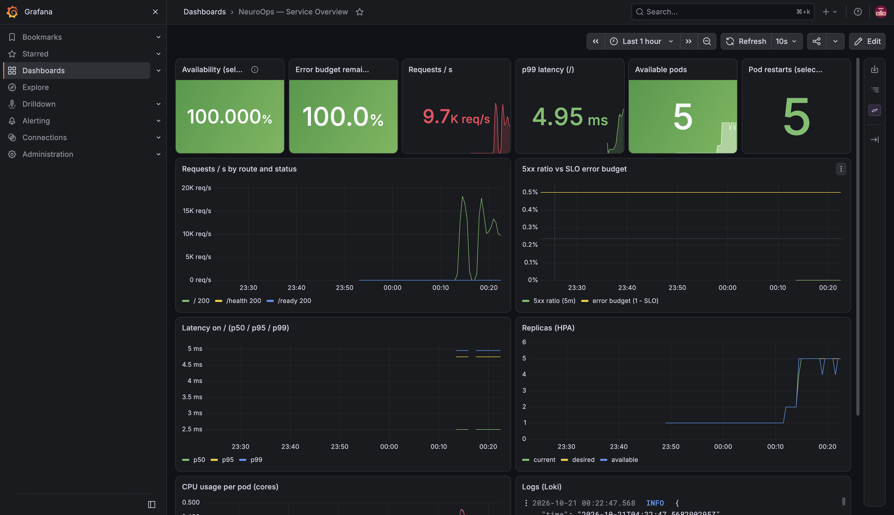
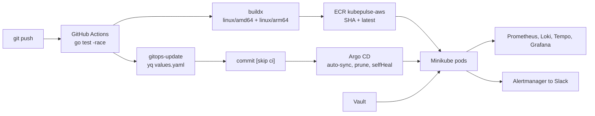

# NeuroOps

A small Go API on Kubernetes that restarts itself when it fails, adds pods when CPU is high, and sends a Slack message when something breaks.

[](app/go.mod)
[](charts/neuroops)
[](charts/neuroops/Chart.yaml)
[](charts/neuroops/templates/prometheusrule.yaml)
[](vault/setup.sh)
[](https://github.com/SamyBaouche/neuroops/actions/workflows/ci-cd.yml)

Personal project by [Samy Baouche](https://github.com/SamyBaouche). I ran it on Minikube on my Mac (Apple Silicon, Docker driver, 4 CPU, 8 GB), not in production.

## What it does

The API is in `app/` (Go 1.26, port 8080):

| Path | What it is for |
| --- | --- |
| `GET /` | normal traffic |
| `GET /health` | Kubernetes liveness: "should this pod be restarted?" |
| `GET /ready` | Kubernetes readiness: "can this pod take traffic?" |
| `GET /fail` | turns the pod unhealthy until Kubernetes restarts it |
| `GET /load` | uses CPU for about 5 seconds, to test autoscaling |
| `GET /metrics` | Prometheus metrics |

After `/fail`, `/` and `/ready` return 503 and `/health` returns 500. A restart clears that.

Kubernetes checks `/ready` every 1 second. One failure removes the pod from the Service. It checks `/health` every 5 seconds and restarts the container after 2 failures. The Horizontal Pod Autoscaler keeps at least 2 pods and scales to 5 when CPU stays above 50%. Each pod asks for `100m` CPU and is capped at `500m` (`100m` = 0.1 CPU).

Prometheus scrapes `/metrics`. Logs are JSON and go to Loki. Traces go to Tempo when tracing is turned on. Grafana shows all of that. Alertmanager posts to Slack. The Slack webhook is stored in Vault, not in Git.

There is also a small terminal CLI in `cli-go/` (`health`, `ready`, `load`, `fail`, `tui`). It only calls the API. It does not deploy anything.

```bash
cd cli-go
go run . health --url "$URL"
go run . tui --url "$URL"
```

## What I measured

100 k6 clients calling `GET /` through `minikube service`. The failure tests used 2 replicas. Those runs used a local image, before GitOps was wired up.

| Test | Requests | Errors | Availability | p99 |
| --- | ---: | ---: | ---: | ---: |
| 2 min, no failures | 2,006,660 | 0.00% | 100% | 31.9 ms |
| 6 min, readiness probe every 5 s | 4,423,709 | 3.56% | 96.44% | 46.1 ms |
| 6 min, readiness probe every 1 s, 10 failures | 2,677,076 | 2.22% | 97.78% | 84.4 ms |

The first row was about 16,700 requests/s (p50 4.25 ms, p95 14.6 ms). Later tests were slower, around 6–7k requests/s, because the laptop and the tunnel were busy after about an hour. That is not a code change.

On the last row, all 10 pods recovered by themselves. Time to Ready: average 19.1 s, min 11.8 s, p95 26.1 s.

I missed my 99.5% availability target on both failure runs. Checking readiness every 1 s instead of every 5 s cut the error rate from 3.56% to 2.22%. The pod starts returning 503 right away, but Kubernetes only stops sending traffic after the next readiness check.

Under CPU load the autoscaler went from 2 to 5 pods. Slack then got `NeuroOpsHPAAtMaxReplicas`, because 5 is the maximum. It also got `NeuroOpsPodRestarted` when a pod failed its liveness probe.




## How it is deployed



Prometheus, Loki, Tempo, and Grafana still run in the cluster. Alertmanager posts to Slack. The webhook comes from Vault.

## GitOps delivery (verified)

A push to `main` is the deploy:

1. GitHub Actions runs `go test -race`.
2. `docker buildx` builds `linux/amd64` and `linux/arm64` and pushes both the commit SHA and `latest` to ECR repository `kubepulse-aws`.
3. The `gitops-update` job uses `yq` to set `image.repository` and `image.tag` in `charts/neuroops/values.yaml`, then commits `chore(gitops): deploy <sha> [skip ci]`.
4. Argo CD (`argocd/application.yaml`) syncs that commit on its own (`automated`, `prune`, `selfHeal`) onto Minikube.

I checked this end to end. A commit that changed the root message was running in the pods. The image tag was the commit SHA `346bc1e`. I did not run `kubectl` or `helm` for that deploy. Commit to pods took about 10 minutes: CI about 8 minutes, mostly the arm64 build under QEMU, then Argo CD, which polls Git every 3 minutes.

Git is the source of truth. `charts/neuroops/values.yaml` holds `hpa.minReplicas: 2`, `alerting.slack.enabled: true`, readiness every 1 second, and `imagePullSecrets`. Those are not `--set` flags.

The ECR repository already existed outside Terraform. I brought it into state with `terraform import` and saw 0 drift. Terraform also sets a lifecycle policy that keeps the 30 most recent images. It still does not create a VPC or EKS.

Minikube pulls the private image with the `registry-creds` addon. The chart references the `awsecr-cred` imagePullSecret. The CI user is a dedicated IAM user with only `AmazonEC2ContainerRegistryPowerUser`.

## Run it locally

Leave the `minikube service` terminal open. On a Mac with the Docker driver, that tunnel is what k6 connects to.

```bash
minikube start --driver=docker --cpus=4 --memory=8192
minikube addons enable metrics-server

minikube image build -t neuroops:local app/
helm upgrade --install neuroops charts/neuroops -n neuroops --create-namespace \
  -f charts/neuroops/values-local.yaml

./monitoring/install.sh
helm upgrade neuroops charts/neuroops -n neuroops \
  -f charts/neuroops/values-local.yaml \
  --set tracing.enabled=true

SLACK_WEBHOOK_URL=https://hooks.slack.com/services/XXX ./vault/setup.sh
helm upgrade neuroops charts/neuroops -n neuroops \
  -f charts/neuroops/values-local.yaml \
  --set tracing.enabled=true
```

`hpa.minReplicas`, Slack alerting, the readiness period, and `imagePullSecrets` already live in `charts/neuroops/values.yaml`. Do not pass them with `--set`. Keep `-f charts/neuroops/values-local.yaml` on these local commands or the pod will try to pull the ECR image instead of `neuroops:local`.

Pushing to `main` is the path that updates the cluster through Argo CD. These Helm commands are only for a fully local image.

```bash
# terminal 1, leave it open
minikube service neuroops-service -n neuroops --url

# terminal 2
k6 run -e BASE_URL="$URL" -e VUS=100 -e DURATION=2m loadtest/traffic.js
k6 run -e BASE_URL="$URL" -e VUS=100 -e DURATION=6m loadtest/traffic.js
INTERVAL=30 ./scripts/inject-failures.sh 10
k6 run -e BASE_URL="$URL" loadtest/autoscale.js
```

Grafana: `kubectl port-forward svc/neuroops-monitoring-grafana 3000:80 -n monitoring`, user `admin`. The password is in the secret `neuroops-monitoring-grafana`.

```bash
kubectl get secret neuroops-monitoring-grafana -n monitoring \
  -o jsonpath="{.data.admin-password}" | base64 -d; echo
```

After a reboot Vault is sealed. Run `./vault/setup.sh` again to unseal it. The unseal key is in `vault/.vault-init.json` (not committed).

## Lessons learned

- This Minikube node is arm64. CI builds both `linux/amd64` and `linux/arm64`. An amd64-only image fails on the node with `exec format error`.
- The GitOps job pushes a commit to `main`. A later `git push` from my laptop can be rejected. I run `git pull --rebase` before pushing.
- Right after the first sync, Argo CD showed Degraded because the HPA had no metrics yet. It became Healthy within a minute.

## Limitations

- CI logs in with static IAM access keys. A production setup would use GitHub OIDC and an IAM role, so there are no long-lived keys.
- `registry-creds` is an unmaintained third-party addon. On EKS I would use IRSA or a node IAM role instead.
- One local Minikube cluster. There is no staging or production promotion.
- Vault is a lab install: I unseal it by hand, TLS is off, and the scripts still use the root token.
- Availability during failures was 96.44%, then 97.78%. The 99.5% target was not reached. I think k6 keeps old connections stuck on the bad pod. I have not tested that yet.
- No Slack buttons, no AI, no EKS. Terraform does not create a VPC or EKS.

## Layout

```text
app/            Go API and Dockerfile
cli-go/         terminal CLI
charts/neuroops Helm chart
monitoring/     Prometheus, Grafana, Loki, Tempo
vault/          Vault install script
loadtest/       k6 scripts
scripts/        injects /fail into a random pod
terraform/      ECR only
argocd/         Argo CD app that syncs main
docs/images/    screenshots
```

## Author

Samy Baouche — Software Engineering, Concordia University — [github.com/SamyBaouche](https://github.com/SamyBaouche) — [linkedin.com/in/samybaouche](https://www.linkedin.com/in/samybaouche)
